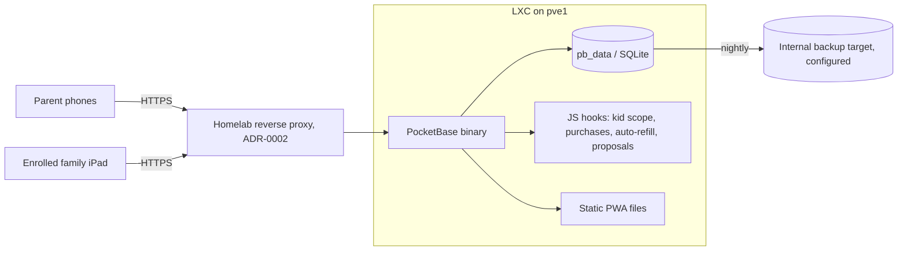

# ADR-0001: PocketBase as the Household Backend

## Context and Problem Statement

The prototype keeps all data in each device's browser storage, so nothing is shared between the family's phones and
the kids' iPad. The production version needs accounts, one shared data store, live updates between devices, per-role
access rules and a way for parents to inspect data — maintained by one person plus agents, self-hosted in the homelab,
without paid services. Which backend should the household app run on?

## Decision Drivers

* Shared state with live updates (SPEC-0001 "Shared State and Live Sync": visible on other devices within 5 s)
* Access control by role (parent / kid device / assistant) enforced server-side
* Small operational footprint: one LXC on pve1, trivially backed up and restored
* Little custom code, so an agent can implement and maintain it from the specs
* No third-party cloud storage of household data

## Considered Options

* PocketBase (single Go binary: SQLite, auth, REST, realtime, admin UI, JS hooks)
* Vikunja (already running in the homelab) as the data backend, with a custom kids' front end
* Custom API (Node or Go) with PostgreSQL
* Hosted backend-as-a-service (Supabase/Firebase)

## Decision Outcome

Chosen option: "PocketBase", because it covers accounts, storage, realtime, per-collection access rules and an admin UI
in one process with one data file, which is the smallest thing that meets every driver, and leaves only the
household-specific rules as custom code.

### Consequences

* Good, because backup and restore are a copy of one directory (`pb_data/`)
* Good, because access rules are declarative per collection, reviewable in one place, and enforced by the server
* Good, because the realtime API removes the need to build sync transport
* Bad, because PocketBase is pre-1.0 — upgrades can break; the version must be pinned and upgrades tested with a restore
* Bad, because household-specific logic (kid scope, purchase recording, auto-refill, proposal acceptance) lives in JS
  hooks, which are less testable than a normal service codebase
* Bad, because SQLite allows one writer at a time — irrelevant at four users, but a ceiling if the assistant ever
  bulk-writes

### Confirmation

The SPEC-0001 scenarios "Shopping item appears on the other phone", "Kid tries the parent view" and "Rebuild after
container loss" pass against the deployed PocketBase instance; `/sdd:check` finds collection rules matching the
role table in SPEC-0001's design.

## Pros and Cons of the Options

### PocketBase

* Good, because auth, REST, realtime (server-sent events), admin UI and file storage ship in one binary
* Good, because multiple auth collections let parents and enrolled devices be separate account types (ADR-0003)
* Good, because the static PWA can be served by the same process
* Neutral, because JS hooks are the extension point — enough for this app, limited for heavy logic
* Bad, because pre-1.0 with occasional breaking changes

### Vikunja as data backend

* Good, because it is already deployed and has users, tasks, labels, due dates and CalDAV
* Bad, because its data model is projects and tasks — routines with kid ticks, areas with owners and purchase history
  would be bent into labels and custom fields
* Bad, because its API permissions are not shaped for "kid device may tick but not read parents' to-dos"
* Bad, because the homelab's Vikunja is wired to agent dispatch; family data does not belong there

### Custom API with PostgreSQL

* Good, because full control over data model, rules and tests
* Bad, because it rebuilds auth, sessions, realtime and an admin UI before any family feature exists
* Bad, because two containers (API + database) to operate, back up and upgrade

### Hosted backend-as-a-service

* Good, because no server to run and mature realtime features
* Bad, because household data, including children's routines, would be stored with a third party
* Bad, because remote availability then depends on an external account and its pricing

## Architecture Diagram

## More Information

Governs SPEC-0001 (Household Platform); the collections and rules are listed in its design. Related decisions:
ADR-0002 (remote access), ADR-0003 (kid access via device accounts), ADR-0004 (configuration stays out of this repo).
