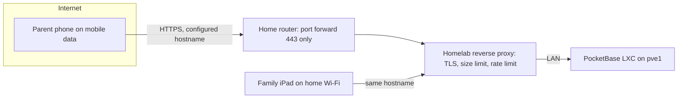

# ADR-0002: Remote Access via the Homelab Reverse Proxy and a Configured Hostname

## Context and Problem Statement

Haushelden runs in the homelab, but its most time-critical use — the shopping list — happens outside the house, on
mobile data. Nothing in the homelab is reachable from outside today. Family members other than the maintainer will
use it on their own phones, so any per-device setup is friction they will feel. How do family phones reach the app
from outside the home network?

## Decision Drivers

* Works on a parent's phone in a supermarket with no extra app or manual step
* No unauthenticated access to household data from the internet (SPEC-0001 "Remote Access")
* TLS trusted by stock iOS, so the home-screen PWA installs and runs without warnings
* Fits the existing homelab patterns (DNS in the household's own domain, nginx reverse proxies, wildcard certificate)
* Contained blast radius if the app has a security bug

## Considered Options

* Homelab reverse proxy with one configured public hostname for Haushelden
* Tailscale (or another VPN) on every family device
* LAN only, no remote access

## Decision Outcome

Chosen option: "Homelab reverse proxy with one configured public hostname", because it is the only option that works
on every family phone without installing or switching on anything, while the app itself enforces authentication on
every data endpoint (ADR-0001, SPEC-0001 Security Requirements).

### Consequences

* Good, because the family uses it like any website or home-screen app — no VPN app, no "turn on Tailscale first"
* Good, because the reverse proxy adds TLS termination, request size limits and rate limiting in front of PocketBase
* Bad, because the app's sign-in page is reachable from the internet; its auth and rate limiting must be correct
  before the hostname goes live
* Bad, because a public DNS record reveals that the service exists; the hostname is configuration (ADR-0004) and must
  not be written into this public repository
* Neutral, because the maintainer must create the DNS record, proxy site and certificate before go-live — this blocks
  deployment, not development

### Confirmation

Before the hostname is published: an unauthenticated request to every data endpoint returns 401; the sign-in rate
limit triggers after 5 failures; the PWA installs and syncs on an iPhone over mobile data; and an external TLS check
shows a valid certificate.

## Pros and Cons of the Options

### Homelab reverse proxy with a configured hostname

* Good, because zero client setup
* Good, because it reuses the homelab's DNS automation, wildcard certificate and nginx role
* Bad, because it exposes an authenticated application to the internet
* Bad, because it depends on the home internet uplink and router port forwarding

### Tailscale on every family device

* Good, because nothing is exposed to the internet; the app is reachable only inside the tailnet
* Good, because access can be revoked per device
* Bad, because every family member must install and keep the VPN app enabled; a phone that dropped off the tailnet
  silently loses the shopping list
* Bad, because iOS PWAs plus VPN-on-demand behaviour is a support burden on the maintainer
* Bad, because pve1 has no Tailscale today; it would be a new homelab-wide dependency for one app

### LAN only

* Good, because there is no exposure at all
* Bad, because the shopping list, reminders and calendar are needed outside the house — it fails the main use case

## Architecture Diagram

## More Information

The hostname, proxy site, certificate and port-forward rule are configuration, kept in the private homelab
infrastructure repository (ADR-0004). Operational requirements are in SPEC-0007 (Deployment and Operations).
