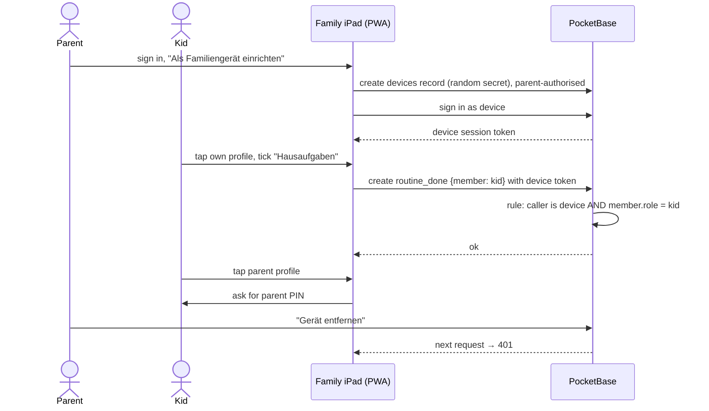

# ADR-0003: Kid Access via Enrolled Device Accounts

## Context and Problem Statement

The kids (8 and 12) use a shared family iPad and pick their profile by tapping their face. They should never need a
password, yet a kid must not be able to read the parents' to-dos or change routines, and access must keep working when
the app is reachable from the internet (ADR-0002). How do kids get into the app without credentials of their own,
while the server still enforces what they may do?

## Decision Drivers

* Kids never type a password
* The server — not the UI — enforces kid scope (tick own routines, add shopping items; nothing else)
* A lost or replaced iPad can be cut off instantly
* Built on PocketBase features rather than custom token code (ADR-0001)
* Parent views on the shared iPad need a lightweight guard against curious kids

## Considered Options

* Device accounts: the iPad is enrolled once by a parent and signs in as its own account type
* Individual kid accounts with simple passwords or picture codes
* Trust the home network: no authentication for kid profiles on the LAN

## Decision Outcome

Chosen option: "Device accounts", because the device, not the child, holds the credential: enrollment happens once,
kids just tap a profile, and the server applies device-scoped rules that cover every kid action.

How it works:
1. A parent signs in on the iPad and taps "Als Familiengerät einrichten".
2. The app creates a record in a separate PocketBase auth collection `devices` with a random 32-byte secret that only
   the app knows; the iPad stores it and signs in as that device.
3. The device keeps its session alive by refreshing its token; nobody ever sees the secret.
4. Each kid action carries the kid's member id; collection rules allow it only when the caller is a device and the
   member is a kid (for example `@request.auth.collectionName = "devices" && member.role = "kid"`).
5. Opening a parent view on the iPad asks for that parent's PIN, which yields a short-lived parent session.
6. "Gerät entfernen" in a parent's settings deletes the device record (or rotates its credentials), which invalidates
   its sessions immediately.

### Consequences

* Good, because kids' access needs no passwords and no per-kid setup
* Good, because kid scope lives in declarative collection rules, reviewable in one place
* Good, because revocation is one tap and immediate
* Bad, because anyone holding the enrolled iPad can act as either kid — acceptable inside one household, and it can
  only tick tasks and add shopping items
* Bad, because the parent PIN is weak authentication; it guards against children, not attackers, and is rate-limited
  (SPEC-0001)

### Confirmation

SPEC-0001 scenarios "Kid opens their board", "Kid tries the parent view", "Kid cannot manage members" and SPEC-0002
"Kid cannot edit routines" pass against the real server, and a removed device receives 401 on its next request.

## Pros and Cons of the Options

### Device accounts

* Good, because a single enrollment covers every kid on the device
* Good, because PocketBase supports multiple auth collections, so devices are first-class accounts
* Neutral, because the client must attach the acting kid's id to writes
* Bad, because per-kid accountability on a shared device rests on the UI, not on credentials

### Individual kid accounts

* Good, because every action is cryptographically tied to one child
* Bad, because the 8-year-old must manage a credential, and lost passwords become a parent chore
* Bad, because there is no real threat between siblings that per-kid credentials would solve

### Trust the home network

* Good, because there is nothing to set up
* Bad, because it breaks the moment the app is reachable from the internet (ADR-0002)
* Bad, because any device on the Wi-Fi, including guests', could read household data

## Architecture Diagram

## More Information

Extends ADR-0001 (relies on PocketBase auth collections and rules). Requirements: SPEC-0001 "Kid Access on Enrolled
Devices", "Device Enrollment and Removal"; SPEC-0002 for the kid-scoped actions.
