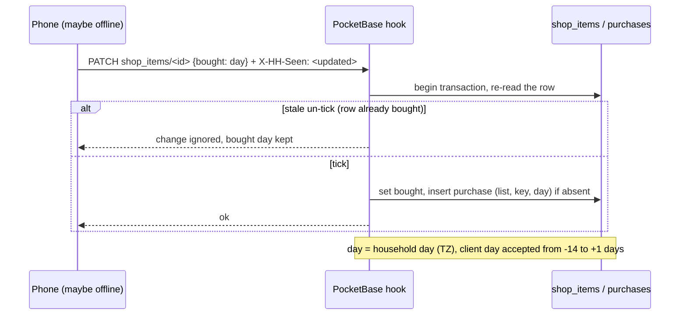

# ADR-0006: Server-Side Purchase Recording with a "Bought Stays Bought" Version Check

## Context and Problem Statement

Ticking an item on the shopping list records a purchase, and the purchase history feeds the learned rhythm (ADR-0007).
Two or more people tick items at the same time, some of them offline in a shop. A lost or duplicated purchase date
corrupts the rhythm, and an item that one device marked as bought must not be un-bought by another device's stale edit
(SPEC-0001 REQ "Offline Operation"). Where are purchases recorded and how is "bought stays bought" enforced?

## Decision Drivers

* A purchase is recorded exactly once per item and day, however often a tick is replayed
* A stale offline edit must never un-buy an item
* Kids' devices may tick but must not be able to rewrite history
* The finish-shopping action must change items and history atomically (SPEC-0001 "Database Operation Standards")

## Considered Options

* Server hooks record the purchase inside the same transaction as the tick, and re-check the record version for
  un-ticks; the client sends the version it saw in a header
* The client writes purchase records itself
* A CRDT for the items

## Decision Outcome

Chosen option: "Server hooks record purchases and re-check versions", because only the server can make the tick and
the history change atomic and keep the history write-protected for devices.

Details as built:
- A hook on `shop_items` create/update/delete writes the `purchases` row (list, name, normalised key, day, item id;
  unique on list+key+day) in the same transaction. An un-tick on the same day removes that purchase; an un-tick on an
  earlier day keeps it.
- "Bought" is a household day string, so a plain boolean `sticky` merge does not fit. The client registers a custom rule
  ("once the server holds a day, a concurrent change loses") with the data layer's merge hook, and the client sends the
  record version it based its change on in an `X-HH-Seen` header. The update hook re-reads the row inside the
  transaction and ignores a stale un-tick.
- The PocketBase JS runtime has no `Intl`, so the hook computes the household day from the configured time zone with
  `date` and falls back to UTC. A client-sent tick day is accepted from 14 days in the past to 1 day ahead, so offline
  ticks keep their real day.
- Duplicate open items per list (case- and whitespace-insensitive) are refused by the server; a duplicate created
  offline on two devices is rejected on replay and stays flagged in the outbox.
- Devices (kids) can read, add and tick items; only parents can delete (so only parents can use "Einkauf fertig" and
  remove items).

### Consequences

* Good, because tick and history are atomic and a replayed tick is harmless
* Good, because the purchase history cannot be rewritten from a kid's device
* Bad, because the client has to carry one more header and the data layer gained a small server-version concept
* Bad, because the day window (14 days back) means a tick replayed after longer offline time records today's day
* Neutral, because a kid-triggered "Einkauf fertig" is not possible in v1 (parents only)

### Confirmation

Rules tests (parent, device, anonymous): one purchase per tick, same-day un-tick removes it, an earlier-day un-tick keeps
it, a stale un-tick is ignored, concurrent ticks and un-ticks converge, a device cannot delete, list deletion cascades.

## Pros and Cons of the Options

### Server hooks with a version check

* Good, because atomic and tamper-resistant
* Good, because it needs no new infrastructure
* Bad, because logic lives in JS hooks (harder to unit test than a service); tests run against a real PocketBase

### Client writes purchases

* Good, because simple
* Bad, because two devices produce duplicates, offline replays double-count, and kids could write any history

### CRDT

* Good, because convergent by construction
* Bad, because heavy for one boolean-with-a-date per item and harder to back up and inspect

## Architecture Diagram

## More Information

Governs SPEC-0005 REQ "Shopping Flow" and "Adding Items"; extends the offline rules of SPEC-0001. The learning on top
of this history is ADR-0007.
