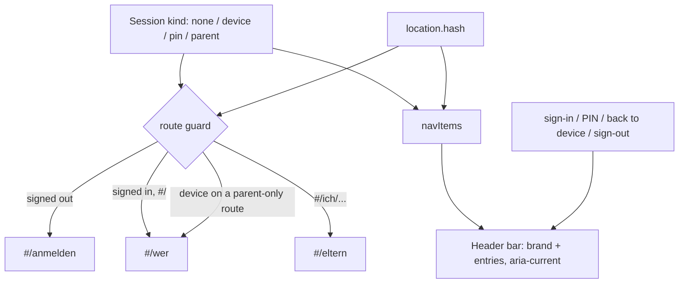

# ADR-0008: Navigation Is Derived From the Session, Rendered Once by the Shell

## Context and Problem Statement

Every feature story built its own screen, but no story owned navigation. After v1 was merged, a parent could not reach
their own view: the start page was still the shell's placeholder, the parent profile pointed at a route that does not
exist (`#/ich/<id>`, left over from the prototype), the parents' view had no links to shopping or settings, and
sub-screens such as the areas editor had no way back. How should navigation be provided so that no screen can be a
dead end again?

## Decision Drivers

* Every screen must offer a way to the other main areas, without each screen having to remember to
* A kids' family device must not be offered parent entries (SPEC-0001 "Kid Access on Enrolled Devices")
* The app is a hash-routed PWA with one route list; a nav target without a route is a bug
* The server rules, not the UI, decide what a session may read (ADR-0003); the UI only avoids empty or confusing pages

## Considered Options

* One navigation bar in the page header, rendered by the shell from the session kind and the current page, plus a route
  guard that decides the start page and keeps family devices off parent-only screens
* Per-screen links and back buttons (what had happened)
* A bottom tab bar

## Decision Outcome

Chosen option: "Header navigation rendered by the shell", because it is the only option where a new screen cannot be
forgotten: the bar exists independently of the screens, and a test checks that every entry has a route.

Details as built:
- The pure function `navItems({ kind, memberId, hash })` (`app/js/shellnav.js`) returns the entries. Signed out: none
  (the brand link leads to sign-in). Parent or PIN session: Wer bist du?, Aufgaben, Einkauf (for the member), Einstellungen.
  Family device: Wer bist du? and Einkauf. The current section carries `aria-current="page"`; the settings sub-screens
  (Routinen, Maskottchen, Bereiche) belong to Einstellungen and the learned overview to Einkauf.
- The bar is re-rendered on every route change and whenever the session changes (sign-in, PIN, back to the device,
  sign-out).
- Route guard (`guard(hash, kind)`): signed out goes to sign-in except the public routes; `#/` for any signed-in session
  goes to "Wer bist du?"; family devices are sent to "Wer bist du?" from the parent-only routes (`eltern`, `routinen`,
  `maskottchen`, `bereiche`, `gelernt`, `einstellungen`); the old address `#/ich/<id>` goes to `#/eltern`.
- Sub-screens that are opened from settings carry a back link to settings.

### Consequences

* Good, because every screen has navigation by construction and the dead-end class of bug is covered by a test
* Good, because what a session sees is decided in one pure, tested function
* Bad, because the header takes space on small phones (it wraps)
* Neutral, because the guard is courtesy only: a device that opens a parent-only address directly still gets nothing
  from the server

### Confirmation

Unit tests for entries per session kind, section highlighting, idempotent rendering and "every nav target has a route";
guard tests for the start page and the parent-only routes.

## Pros and Cons of the Options

### Header navigation from the session

* Good, because one place, tested
* Bad, because a screen that wants a different layout cannot hide it

### Per-screen links

* Good, because each screen controls its own layout
* Bad, because it failed in practice: five stories shipped without any way to reach the parents' view

### Bottom tab bar

* Good, because thumb-friendly on phones
* Bad, because more layout work and it competes with the on-screen keyboard and the quick-add field

## Architecture Diagram

## More Information

Governs SPEC-0008 (App Shell and Navigation). Extends ADR-0003, which defines the session kinds.
