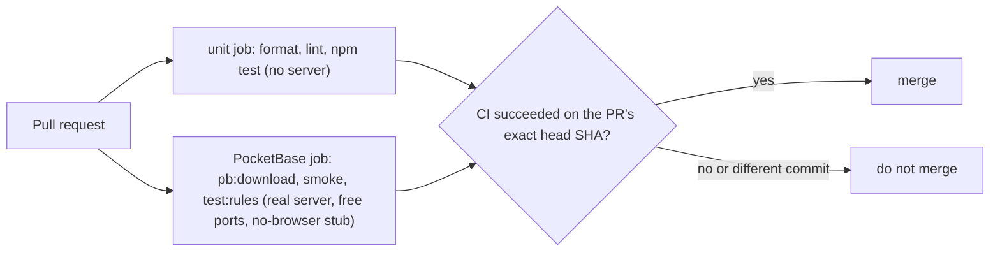

# ADR-0009: Test Layers, Throwaway Servers That Cannot Disturb the Developer, and a Merge Gate on the Exact Commit

## Context and Problem Statement

v1 was built by several agents working in parallel against one repository, with most security behaviour living in
PocketBase rules and JavaScript hooks that cannot be unit tested without a server. Four problems appeared along the way:
PocketBase-backed tests silently skipped in the job that had no PocketBase binary, so "CI is green" proved nothing about
the backup scripts; two parallel test files shared a fixed port and caused a flaky failure; throwaway servers opened
browser tabs on the developer's machine; and a merge was nearly done on a CI result for a different commit than the
pull request's head. What test layers, conventions and merge rule prevent this?

## Decision Drivers

* The rules and hooks are the security model and must be tested against a real PocketBase
* A green check must prove something: no silent skips
* Tests run in parallel; they must not interfere with each other or with the developer's dev server
* Running the tests must never touch the developer's desktop (browser, ports, data)
* The repository is public (ADR-0004): test data is fake

## Considered Options

* Layers by what they need (pure unit, fake-DOM screens, real-PocketBase rules tests, smoke), enforced by directory;
  throwaway servers on free ports and temp data with a stub in front of the PATH; merge only when CI succeeded on the
  PR's exact head commit
* Mock PocketBase in all tests
* Browser end-to-end tests only

## Decision Outcome

Chosen option: "Layers by directory, quiet throwaway servers, exact-commit merge gate".

Conventions:
- `test/*.test.js` are pure unit tests and screen tests with the fake DOM helpers (`test/helpers/fake-dom.js`,
  `fake-dom-nodes.js`). They need no server. Anything that needs a real PocketBase lives under `test/rules/`, which runs
  in the CI job that downloads the pinned binary and fails loudly (a "prerequisites" test) when the binary or `sqlite3`
  is missing; such tests never skip silently.
- Throwaway servers use free ports (or a documented fixed range, never shared between files that run in parallel), a
  temporary data directory, and `scripts/no-browser.js`: PocketBase opens its "create the first admin" page in the default
  browser when it starts on a data directory without a superuser, so every throwaway server runs with no-op `open` and
  `xdg-open` launchers first on the PATH that only record the request. A test starts exactly that situation and asserts
  the launch lands in the stub.
- CI runs on every pull request: format check, lint, unit tests, then in the PocketBase job the smoke test and
  `test:rules`.
- A pull request is merged only when a CI run for its exact head commit has succeeded. When the branch is behind
  `main`, `main` is merged into it, the full local suite runs, and CI must pass on the resulting commit.
- Fake data only (Test-Papa, Test-Mama, Test-Kind-1, Test-Kind-2); the dev seed can create them, production never has
  seed data.

### Consequences

* Good, because the security-relevant behaviour is tested where it lives, and "green" means everything ran
* Good, because parallel runs and the developer's own server do not collide
* Bad, because the real-PocketBase job is slower than unit tests
* Bad, because two fake-DOM helpers exist side by side (a known duplication)
* Neutral, because real-browser behaviour (service worker on a device, layout, speech voices) is verified by hand only

### Confirmation

CI shows no skipped tests; the no-browser test passes on Linux and macOS; the merge rule is followed in the pull request
history.

## Pros and Cons of the Options

### Layers, quiet servers, exact-commit gate

* Good, because each problem seen has a mechanical guard
* Bad, because conventions must be kept up as the suite grows

### Mocking PocketBase

* Good, because fast
* Bad, because the rules and hooks are exactly what must not be mocked

### Browser end-to-end only

* Good, because closest to what users do
* Bad, because slow, flaky, and it would put browser windows on the developer's machine

## Architecture Diagram

## More Information

Governs SPEC-0007 REQ "Local Development" and the repository's CI. The browser-tab incident is the reason for
`scripts/no-browser.js`; the shared-port incident is why `test/rules/log-server.test.js` uses its own port.
