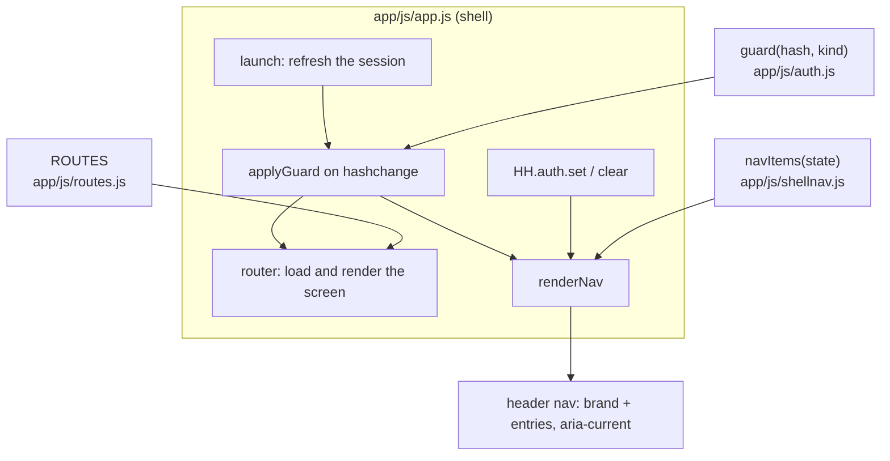

# Design: App Shell and Navigation

## Context

The app is a hash-routed single-page PWA served by PocketBase (SPEC-0001, ADR-0001). A small shell (`app/js/app.js`)
boots storage, the auth flow, the data layer and the router; screens register themselves in one route list
(`app/js/routes.js`, one line per route). v1 shipped every feature screen without a story that owned the paths between
them, so a parent could not reach their own view (ADR-0008). SPEC-0008 states what navigation must do; this document
records how it is built.

## Goals / Non-Goals

### Goals
- No screen is a dead end, and no new screen can be forgotten by the navigation
- What a session is offered is decided in one pure, tested function
- A family device never lands on an empty parent screen

### Non-Goals
- Deep linking with arbitrary state, nested routers, or animated transitions
- A bottom tab bar or a hamburger menu (revisit if the header wraps badly on phones)
- Hiding data: the server rules do that

## Decisions

### Navigation items come from a pure function

**Choice**: `navItems({ kind, memberId, hash })` in `app/js/shellnav.js` returns `{ key, label, href, current }` entries;
`render(nav, state, doc)` fills the header `<nav>`. The module works under Node (tests) and in the page.
**Rationale**: Pure input and output make the per-session rules and the section highlighting trivially testable, and a
test can check every `href` against the route list.
**Alternatives considered**: see ADR-0008 (per-screen links, bottom tab bar).

### The shell re-renders the bar on route and session changes

**Choice**: `renderNav()` in `app/js/app.js` runs after the router starts, on every `hashchange` (registered after the
guard, so it sees the final hash) and from the auth object's `set` and `clear`, so sign-in, PIN entry, return to the
device and sign-out update it even when the hash does not change.
**Rationale**: The session can change without a navigation (the PIN timer ends a parent session while the page stays
on "Wer bist du?"), so hash events alone would leave stale entries.

### The route guard decides the start page and parent-only screens

**Choice**: `guard(hash, kind)` in `app/js/auth.js` returns the hash to show instead of the requested one, or null. Rules in
order: signed out → sign-in (except the public routes); sign-in or setup while signed in → "Wer bist du?"; the legacy
`ich` route → the parents' view; a family device on a parent-only route → "Wer bist du?"; the start address for any
signed-in session → "Wer bist du?".
**Rationale**: The shell's placeholder start page proved only that sync works; everybody signed in starts at the profile
chooser, which already knows about the session kind.

### The legacy `#/ich/<id>` address is an alias

**Choice**: keep the old address working by redirecting it in the guard.
**Rationale**: Cached pages and bookmarks from before the fix still use it; a redirect costs one line and one test.

### Text selection is on by default

**Choice**: only `button`, `.tile`, `.profile`, `.shopbtn` and `.check` set `user-select: none`.
**Rationale**: a global `user-select: none` (carried over from the kids' tile design) made no text copyable. A stylesheet
test inspects every rule that disables selection so the regression cannot return unnoticed.

## Architecture

| Session kind | Entries | Parent-only screens |
|--------------|---------|---------------------|
| none | brand → sign-in | — (guard sends to sign-in) |
| device | Wer bist du?, Einkauf | redirected to "Wer bist du?" |
| pin | Wer bist du?, Aufgaben, Einkauf, Einstellungen | open |
| parent | Wer bist du?, Aufgaben, Einkauf, Einstellungen | open |

## Risks / Trade-offs

- **The header wraps on narrow phones** → the bar is a wrapping flex row; a bottom tab bar is the fallback if it feels
  crowded in real use.
- **Guard and rules can drift apart** → the guard is a courtesy; the rules tests are what prove access control.
- **A new screen is added without a nav entry** → entries are only for top-level areas; a screen that is a sub-screen of
  an existing area is mapped to its section in `SECTION`, and the "every target has a route" test covers the other
  direction.
- **No "page not found" link** → the router shows a plain message; the header is the way out.

## Migration Plan

Shipped with PRs #55 (guard, parent profile target, parent nav row), #56 (legacy address), #57 (selectable text), #58
(global bar, replaced the one-off row). No data migration.

## Open Questions

- Does the header need a "Kalender" entry, or is the mode switch inside "Aufgaben" enough?
- Should a kid's board offer the shopping list directly instead of only through the header?
- Should "Seite nicht gefunden" offer its own link to the start page?
