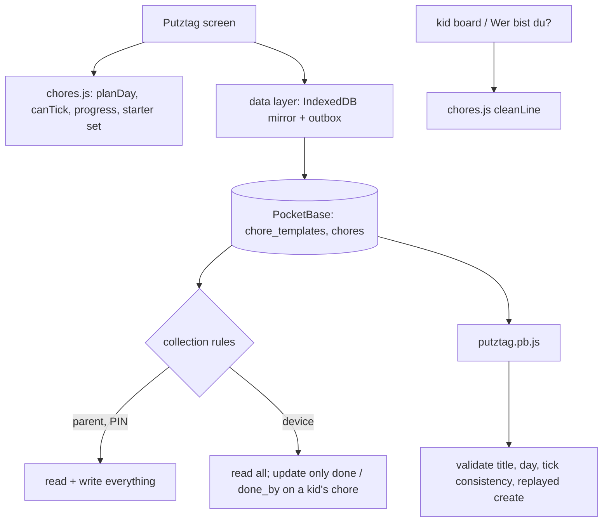

# Design: Family Cleaning Day

## Context

Kathrin sent a printable "family cleaning day" checklist with three columns: kids, dad, mom. The household wants the same
thing in the app, with the rules of the rest of Haushelden: everybody reads everything, parents manage, kids only act on
what is theirs, everything works offline and syncs live. This design follows the meal plan (SPEC-0009, ADR-0003): client-side
logic in a pure module, rules in the collections, thin hooks for validation, no new HTTP route.

## Goals / Non-Goals

### Goals
- One shared list per cleaning day that every member sees in full
- Kids can tick exactly their own chores, enforced by the collection rules
- A standard set that the family owns and extends, starting from Kathrin's list
- No new route, no new server concept beyond two collections and a validation hook

### Non-Goals
- Recurrence, rewards, reminders (see Open Questions)
- Telling two children on a shared iPad apart (ADR-0003)

## Decisions

### Two collections, no "cleaning day" record

**Choice**: `chore_templates` (the standard chores) and `chores` (the items of a day, with a `day` date). A cleaning day exists
exactly when chores with that date exist.
**Rationale**: A day record would carry no data of its own (no title, no state) and would need cascade rules and a unique
index. Deleting a day deletes its chores, which is all "delete the day" has to mean. The set of days is a `distinct day` over
the mirror.
**Alternatives considered**:
- A `clean_days` collection: extra record, extra rules, nothing to put in it.
- Reusing `todos`: they are per-parent with areas and due dates and would mix cleaning chores into the parents' list.
- Reusing `routines`: those repeat on weekdays and are the kids' daily tiles; a cleaning day is a one-off event.

### Starting a day happens in the client

**Choice**: The screen computes which chores to create (`planDay`, pure) from the templates, the existing chores and the
members, and creates them through the data layer. There is no server route.
**Rationale**: It works offline like every other write and needs no new authenticated route, body limit or rate limit. Two
parents starting the same date at the same moment could produce duplicates; both are harmless and deletable, and a unique
index would instead leave a rejected write in the loser's outbox.
**Alternatives considered**: a `POST /api/hh/putztag/start` like the ingredient route. Atomic, but online-only and one more
surface to secure for a rare race.

### "For each child" is expanded when the day starts

**Choice**: A template has `kids` (boolean) and an optional `assignee`. `kids` produces one chore per kid member at start time;
the chores then live independently of the template.
**Rationale**: The checklist's kids' part is "everyone's own room"; two children means two ticks. Expanding at start keeps
the rules simple (a chore always has at most one assignee) and survives a child being added or removed later.

### Rules: devices may only tick, and only as the assignee

**Choice**: `chores` update by a device is allowed when the assignee is a kid member, the body does not touch `title`, `day`,
`assignee` or `template`, and `done_by` is empty (un-tick) or equals the assignee. Parents may set `done_by` to themselves or
the assignee. A hook keeps `done` and `done_by` consistent (done needs a `done_by`, not done needs none). Reassigning clears the tick.
**Rationale**: This is as strong as the platform can make it on a shared device: a device can never touch a parent's chore, an
unassigned one, or the text of any chore. Which child is "the assignee" is the profile chosen on the device, the same trust as ticks and votes.

### Interval for rare chores

**Choice**: `every_days` on the template (0 = every cleaning day, 14, 30). A chore of that template is left out of a new day when
a chore from the same template was **done** on a cleaning day less than `every_days` earlier.
**Rationale**: "Staubsaugerfilter reinigen (monatlich)" is in the source list. Counting only done chores means a chore nobody
did comes back on the next day instead of waiting a month.

### The starter set is data in the app, imported once into the collection

**Choice**: `app/js/chores.js` holds the German starter chores in three groups (Kinder, Papa, Mama). A parent imports them; the
import asks which parent takes which parent group, then creates normal templates. Nothing in the database is special.
**Rationale**: The set belongs to the family afterwards (editable, deletable); the app has no knowledge of who "Papa" is.
The cat litter box from the source list is included because it is on Kathrin's list; deleting it is one tap.

### Screen structure

**Choice**: `#/putztag/<member id>` with two tabs, "Putztag" (the day list, the new-day panel for parents) and "Vorlagen" (parents:
the standard chores). The kid chips of the meal plan screen are reused for a device opened without a profile.

## Architecture

## Risks / Trade-offs

- **Two children on one iPad can tick each other's chores** → accepted, same as ticks and votes; the screen offers a child only their own.
- **Duplicate chores after a simultaneous start** → harmless, deletable; the second start from the same screen adds only what is missing.
- **The header gets longer** (Wer bist du?, Aufgaben, Einkauf, Essen, Putztag, Einstellungen, Hilfe) → it already wraps; revisit with the bottom bar idea in SPEC-0008.

## Migration Plan

One migration creates both collections. No data migration; the standard set is empty until a parent imports the starter set.

## Open Questions

- Should a cleaning day repeat (every second Saturday)? Probably a "Wiederholen" button on a finished day first.
- Should the mascot celebrate a finished cleaning day like a finished kids' board?
- Should finished chores show a points or streak for kids? Kathrin has not asked.
