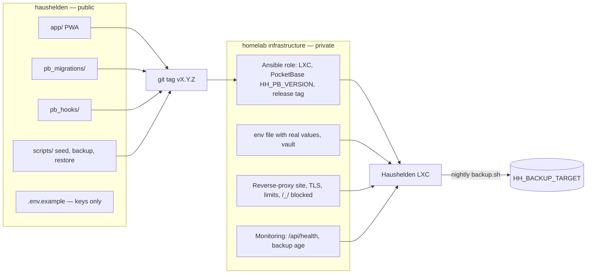
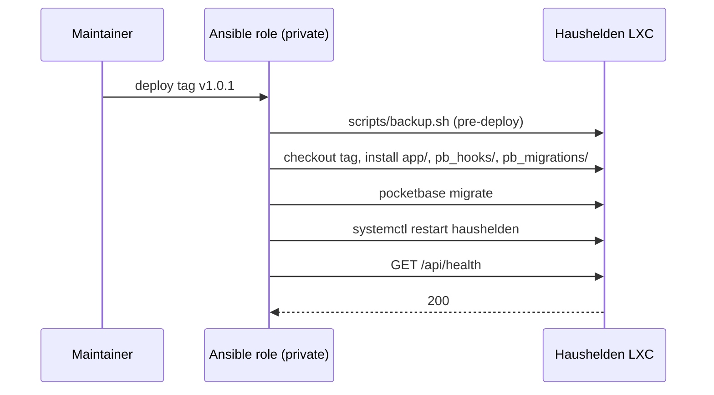

# Design: Deployment and Operations

## Context

SPEC-0007 turns ADR-0001 (PocketBase), ADR-0002 (reverse proxy + configured hostname) and ADR-0004 (configuration in the
private homelab repository) into an operable service. The homelab already provisions containers with Ansible from a
private repository, runs nginx reverse proxies with a wildcard certificate for the household's domain, keeps an
internal backup target, and has monitoring with alerting. Haushelden should look like every other homelab service so
the same habits and agents can run it.

## Goals / Non-Goals

### Goals
- An implementer can build and test everything on a laptop with no homelab access
- Deploying a release is one command in the private repository and is reversible
- Nothing that identifies the homelab ends up in this public repository
- The public hostname is published only after the security checklist passes

### Non-Goals
- Deployment pipelines (CD) or container registries — a git tag plus provisioning is enough for one household. Pull-request checks (lint, format, tests, a PocketBase smoke test) are CI and are in scope.
- High availability or multiple replicas
- Kubernetes, Docker, or any orchestration layer

## Decisions

### Split of responsibilities between the two repositories

**Choice**: This repository: `app/`, `pb_migrations/`, `pb_hooks/`, `scripts/` (seed, backup, restore), `.env.example`,
`docs/`. Private homelab repository: the LXC definition, an Ansible role that installs the pinned PocketBase and a
tagged release of this repository, the env file with real values (vault), the reverse-proxy site, the backup timer's
target, DNS, monitoring checks.
**Rationale**: ADR-0004 — values in private, mechanisms in public. Scripts that need a target receive it via env var.
**Alternatives considered**:
- Everything in the private repository: the app could not be built or reviewed in public, and the prototype history
  already lives here.

### Schema as PocketBase migrations

**Choice**: Collections and their rules are defined only through JS migration files in `pb_migrations/`, never edited
by hand in the admin UI in production.
**Rationale**: Rules are the security model (SPEC-0001 design); migrations make them reviewable, diffable and
reproducible on a laptop, a scratch container and production.

### Release = git tag, deploy pulls the tag

**Choice**: The Ansible role checks out a given tag of this repository into the container, runs `pocketbase migrate`
after a pre-deploy backup, and restarts the systemd unit.
**Rationale**: No build step exists (vanilla JS PWA), so a tag is the artifact; rollback is "deploy the previous tag".

### Backups via SQLite online backup, written to the configured target

**Choice**: A systemd timer runs `scripts/backup.sh`, which uses PocketBase's backup API (or `sqlite3 .backup`) to
produce a consistent snapshot, copies it to `$HH_BACKUP_TARGET`, and prunes by `$HH_BACKUP_RETENTION_DAYS`.
**Rationale**: Copying a live SQLite file can capture a torn write; the online backup is consistent and cheap at this
size.

## Architecture

## Risks / Trade-offs

- **Secrets leaking into git history** → `.env` is gitignored; `.env.example` holds placeholders; a pre-commit secret
  scan (as used in the homelab's other repositories) SHOULD run here too.
- **Migration that cannot be reversed** → the mandatory pre-deploy backup is the rollback path; destructive migrations
  are split into add-then-remove releases.
- **Home uplink or router outage** → the app is unreachable from outside; devices keep working offline with cached data
  (SPEC-0001 Offline Operation).
- **Pinned PocketBase falls behind on security fixes** → monitoring of upstream releases is manual; check release notes
  monthly.

## Migration Plan

1. Add `app/`, `pb_migrations/`, `pb_hooks/`, `scripts/`, `.env.example` to this repository; keep the prototype at root.
2. In the private repository: LXC definition, Ansible role, vault values, proxy site (LAN-only first), backup timer,
   monitoring checks.
3. Deploy, run first-run setup on the LAN, enroll devices, restore-test.
4. Run the Go-Live Checklist, then publish DNS and the port forward.

## Open Questions

- Which existing monitoring system gets the health and backup-age checks?
- Does the reverse proxy already have a reusable rate-limit snippet for authentication paths, or does this need a new one?

## As Built: Notes and Known Gaps

- Backups use `sqlite3 .backup` on the databases (PocketBase's backup API would need superuser credentials as extra
  configuration), with an integrity check; `HH_BACKUP_TARGET` accepts a directory path only (the `.env.example` comment that
  said "path or URL" is wrong for v1). Retention is age-based. A rollback for a release with a migration is a documented manual
  procedure (previous tag plus restore), not automated.
- `scripts/deploy.sh <tag>` takes a pre-deploy backup first and aborts without changes if it fails, installs `app/`,
  `pb_migrations/` and `pb_hooks/` from the tag, migrates, restarts and polls `/api/health`.
- Logging: `pb_hooks/lib/log.js` writes key=value lines with a UTC `ts`, redacts keys that look like secrets, strips query
  strings and logs failed sign-ins without credentials; PocketBase's own log retention is set to 14 days.
- Test layers, throwaway servers and the merge gate are decided in ADR-0009; the setup of the real LXC, the units and the
  timer lives in the private homelab repository.
- Not tested: the systemd units under systemd, journald retention, the stale-backup alert, and the real LXC side.
