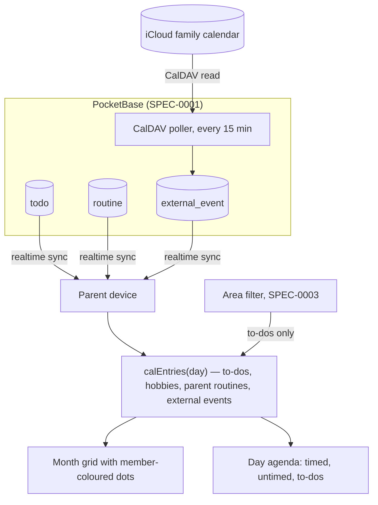

# Design: Family Calendar

## Context

The parents asked for a calendar view inside their own view (SPEC-0004). The prototype builds the month from local
data only: dated to-dos, kids' hobbies and parents' routines. The family's real appointments already live in a shared
iCloud calendar on the iPhones, and nobody wants a second calendar to maintain. The calendar should therefore be a
lens that combines Haushelden data with iCloud, not a calendar product of its own.

## Goals / Non-Goals

### Goals
- See the family's week at a glance: who has what, which days are busy
- Plan to-dos onto days directly from the calendar
- Show iCloud appointments without anyone entering them twice

### Non-Goals
- Replacing the iPhone Calendar app (event editing, invitations, alarms)
- Week or day timeline views with hour grids
- Showing kids' daily chores (they would flood every day)

## Decisions

### Calendar is a computed view, not stored events

**Choice**: Day entries are computed on the device from `todo.due`, routine weekdays (`kind = hobby` for kids, any for
parents) and a server-side cache of iCloud events.
**Rationale**: No duplicate state to keep in sync; editing a routine's weekdays updates every future week instantly.
**Alternatives considered**:
- Materialise routine occurrences as events: needs regeneration on every routine edit and invites drift.

### iCloud via server-side CalDAV read

**Choice**: The server polls the shared iCloud calendar with an app-specific password every 15 minutes and stores
events for the visible window (−1 to +3 months) in an `external_event` collection that syncs like other data.
**Rationale**: Family devices never hold iCloud credentials; offline devices still show cached events; one integration
point for the assistant to write approved events later.
**Alternatives considered**:
- Subscribed ICS URL (public share link): simpler but read-only and the URL is a bearer secret that leaks easily.
- Device-side EventKit: impossible from a PWA.

### Markers coloured by member, capped at four

**Choice**: One dot per entry in the owner's colour (both parents → both colours), max four per day.
**Rationale**: Readable on a phone-width month grid; colour already means "person" everywhere in the app.

## Architecture

## Risks / Trade-offs

- **App-specific password expires or is revoked** → poller marks events stale and surfaces a settings warning to
  parents; the rest of the calendar keeps working.
- **iCloud CalDAV quirks (time zones, recurring exceptions)** → use a maintained CalDAV/iCalendar library with RRULE
  expansion on the server; never parse ICS by hand.
- **Four-dot cap hides entries** → the agenda shows everything; the dots only signal "busy".

## Migration Plan

Greenfield on the server side. The prototype's calendar logic (`calEntries`) ports as-is; only `external_event` is new.

## Open Questions

- Which iCloud calendar is "the family calendar" — one shared calendar, or several (one per person)?
- Should approved assistant events (e.g., soccer games from WhatsApp) go into iCloud or stay Haushelden-only?
- Are school holidays worth importing (Bavarian holiday ICS) so routines can pause automatically?
