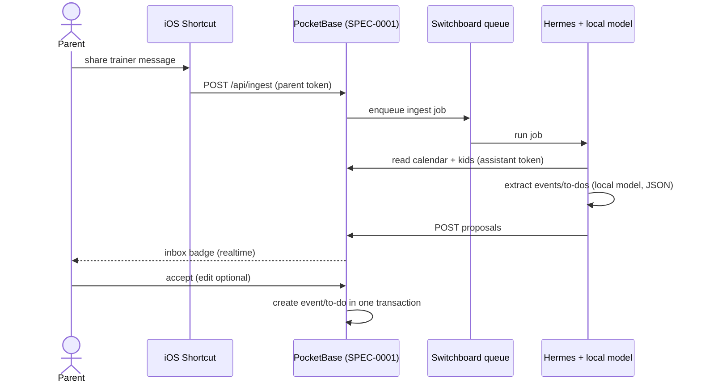
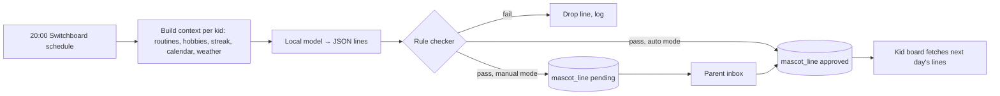
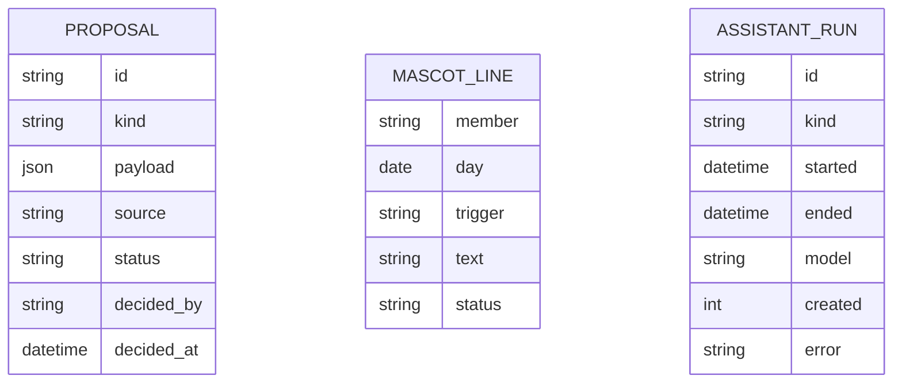

# Design: Household Assistant

## Context

The household already runs Hermes, an LLM agent with a local model on the homelab, a job queue (Switchboard) and a
messenger channel to the parents. The homelab's operating rule for agents is "agents propose, a human approves" —
the same gate SPEC-0006 applies to family data. Two concrete needs drive this spec: mascot lines for the kids
(SPEC-0002) that stay fresh without parents writing them, and the son's soccer organisation, which arrives as
unstructured WhatsApp messages from trainers. WhatsApp has no official API for personal accounts, and unofficial
bridges risk an account ban.

## Goals / Non-Goals

### Goals
- Fresh, context-aware mascot lines every day with no parent effort beyond an optional glance
- Turn a pasted trainer message into a correct calendar entry in two taps plus one approval
- Keep every assistant output reviewable and every failure harmless

### Non-Goals
- A chat interface to the assistant inside the app
- Reading WhatsApp automatically (no bridges, no account automation)
- Any external LLM API, even as a fallback
- The assistant acting on kids' devices directly

## Decisions

### Proposals are the only write path

**Choice**: The assistant's token can create `proposal` and `mascot_line` records only. Accepting a proposal is a
parent action that creates the real record server-side in one transaction.
**Rationale**: Makes "the agent cannot break the family's data" a property of the server, not of the prompt. Same shape
as the homelab's Vikunja/Gitea gating, so it is already familiar.
**Alternatives considered**:
- Direct writes with an undo log: still shows unreviewed content to the family until someone undoes it.

### Share sheet → Shortcut → ingest endpoint

**Choice**: An iOS Shortcut on each parent's phone accepts shared text and POSTs it to `/api/ingest` with the parent's
token; the server enqueues a Switchboard job for Hermes; Hermes writes proposals back.
**Rationale**: Works with WhatsApp's normal "share/export chat" and copy-paste, needs no WhatsApp automation, and reuses
the existing queue so retries and logging come for free.
**Alternatives considered**:
- Unofficial WhatsApp bridge (whatsmeow/mautrix): automatic, but risks a ban on a parent's personal number.
- Forward to a Signal/Telegram bot: one more app in the loop; the Signal bot is blocked on a second phone number anyway.

### Nightly mascot batch with a rule-checker gate

**Choice**: A scheduled Switchboard job at 20:00 builds per-kid context (tomorrow's routines and hobbies, streaks,
calendar, weather), asks the local model for structured JSON lines per trigger, runs a deterministic checker (length,
German, no sibling names in the other kid's lines, no reward words, banned-phrase list), and stores lines as `pending`
(manual mode) or `approved` (auto mode).
**Rationale**: Batch means kids' devices just fetch text; the checker makes auto-approval safe enough for a household,
and manual mode exists for the first weeks while the family builds trust.
**Alternatives considered**:
- LLM-as-judge for approval: adds a second model call and is itself unreviewable; deterministic rules cover the
  content policy that matters.

## Architecture

## Risks / Trade-offs

- **Local model quality for German extraction** → constrain output to JSON with a schema, keep prompts short, and
  remember that a parent reviews every proposal anyway; measure acceptance rate in the audit log.
- **Model availability (single-slot local model shared with other jobs)** → nightly run is scheduled outside busy hours
  and failures degrade to fallback lines (Failure Isolation).
- **Children's data in prompts** → never leaves the homelab; prompts use first names only; logs store counts, not
  full prompts.
- **Shortcut setup per phone** → one-time, documented; the share-sheet path is also usable as copy-paste into an
  in-app text box.

## Migration Plan

Greenfield. Ship in this order: proposals inbox + assistant identity, mascot lines in manual mode, message ingestion,
auto-approval, shopping normalisation last.

## Open Questions

- Which weather source (local Home Assistant forecast entity or an open API) feeds the mascot context?
- Manual or automatic mascot approval as the starting default?
- Should ingestion also accept photos of paper notes from school (needs a local vision model)?

## As Built: Status

Not built in v1 (SPEC-0001 "Version 1 Scope"). The only seam in the code is `approvedLines()` in `app/js/board.js`, which returns
no lines, so the kid board uses its built-in German line pool. The proposals inbox, the assistant identity, message ingestion
and nightly line generation all follow after v1.
