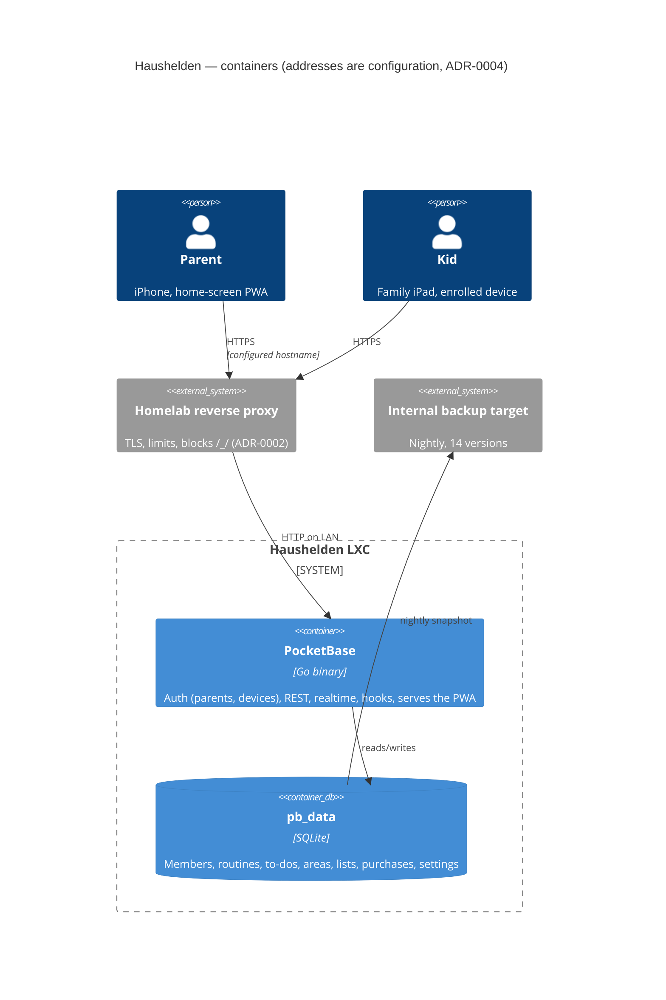
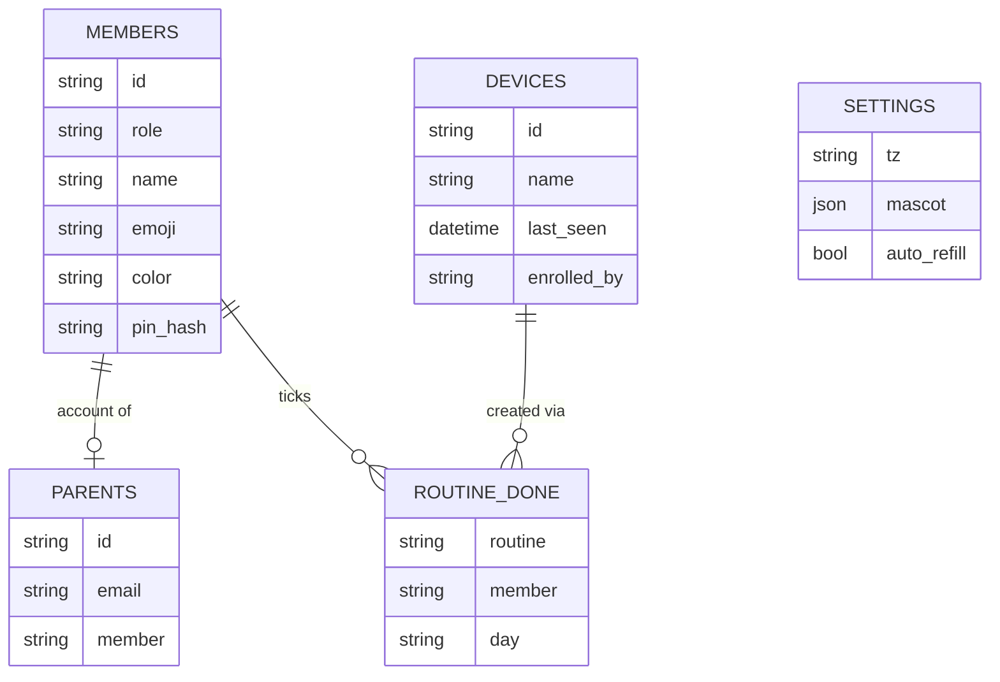

# Design: Household Platform

## Context

The prototype proved the interaction design with the family but stores everything per device. The household has two
parents with iPhones, two kids (8 and 12) sharing a family iPad, and a homelab with a Proxmox node, an LLM agent with a
local model, nginx reverse proxies, DNS automation for the household's own domain, and an internal backup target.
This repository is public, so everything deployment-specific lives in the private homelab repository (ADR-0004).

Constraints: no paid SaaS; household data stays in the homelab; one maintainer plus agents — the stack must be small
enough to implement and maintain from these specs. Decisions: PocketBase (ADR-0001), reverse proxy plus configured
hostname (ADR-0002), device accounts for kids (ADR-0003). Deployment and operations: SPEC-0007.

## Goals / Non-Goals

### Goals
- One shared, live data set for four people on a handful of devices
- Kids never type a password; parents' data is not readable by kids
- Works in a supermarket with poor signal
- Rebuildable from provisioning code plus backup in under an hour
- Keep the prototype's single-page PWA and its UI so the design work carries over

### Non-Goals
- Multiple households, invitations beyond the second parent, anything multi-tenant
- Native iOS apps or App Store distribution
- Fine-grained per-record sharing beyond the parent / device / assistant roles
- Push notifications (SPEC-0003 "Reminders", later)

## Decisions

### Backend: PocketBase in one LXC (ADR-0001)

**Choice**: PocketBase serving the API, realtime, admin UI and the static PWA from one process; schema as committed
PocketBase migrations (`pb_migrations/`); household logic as JS hooks (`pb_hooks/`).
**Rationale**: Covers accounts, storage, realtime and access rules with one binary and one data directory; schema and
rules live in the repo, so they are reviewed and versioned like code.
**Alternatives considered**: see ADR-0001 (Vikunja, custom API with PostgreSQL, hosted BaaS).

### Three principal types, rules per collection

**Choice**: Two PocketBase auth collections — `parents` (e-mail + password, linked 1:1 to a `members` record) and
`devices` (enrolled family devices, ADR-0003) — plus a third, server-side-only identity for the assistant (SPEC-0006,
later). Every household collection has explicit list/view/create/update/delete rules by principal type.
**Rationale**: PocketBase rules are the security model; keeping principal types few and explicit makes the rule table
below reviewable and testable.

| Collection | Parent | Device (kid actions) | Notes |
|------------|--------|----------------------|-------|
| `members` | full | read | role, name, emoji, colour, pin_hash (hidden field) |
| `routines` (SPEC-0002) | full | read | |
| `routine_done` (SPEC-0002) | full | create/delete where `member.role = "kid"`; read today | unique (routine, member, day) |
| `todos`, `areas` (SPEC-0003) | full | none | |
| `lists` (SPEC-0005) | full | read | |
| `shop_items` (SPEC-0005) | full | read, create, update `bought` | `by` must be a member; kids cannot delete lists |
| `purchases` (SPEC-0005) | read, delete (reset) | none (written by hook) | maintained server-side on tick/un-tick |
| `settings` (mascot, auto-refill, time zone override) | full | read | single record |
| `mascot_lines` (SPEC-0006, later) | read, approve | read approved for today | |
| `proposals` (SPEC-0006, later) | full | none | |
| `external_events` (SPEC-0004, later) | read | none | written by the CalDAV poller |

### Custom routes under `/api/hh/`

**Choice**: Six small hook routes for what PocketBase does not do by itself: `setup` (one-time first parent),
`invite` / `invite/accept` (second parent), `devices/enroll` (create a device account on behalf of the signed-in
parent), `pin` (verify a parent PIN from a device, issue a 15-minute parent token), `export` (all household data as
JSON). Everything else uses PocketBase's standard collection and realtime API.
**Rationale**: Keeps custom code to the edges where the household's rules differ from a generic backend.

### Kid access via device accounts (ADR-0003)

**Choice**: Enrollment generates a ≥32-byte random secret on the device, creates a `devices` record with it via
`/api/hh/devices/enroll` (parent-authorised) and signs in as that device; the device refreshes its token on launch.
Removal deletes the device record, which invalidates its tokens.
**Rationale**: Uses PocketBase's own auth for devices; no hand-rolled token scheme.
**Alternatives considered**: see ADR-0003 (kid accounts, LAN trust).

### Day boundaries in household time

**Choice**: A `day` is a `YYYY-MM-DD` string computed in the household time zone (`HH_TZ`, default Europe/Berlin) on
both client and server; all day-based records store that string, never timestamps.
**Rationale**: Streaks, alternation and auto-refill must agree across devices; storing the household date avoids
time-zone drift when a phone travels. The prototype's day-number arithmetic maps directly onto these dates.

### Offline: service worker shell + local write queue

**Choice**: Network-first service worker for the app shell (as in the prototype), an IndexedDB mirror of the records
the principal may read, and an outbox of mutations replayed in order on reconnect. Conflict rule: last write by server
receipt wins per field; `bought` is sticky.
**Rationale**: Offline moments are short (supermarkets, the car) and the data is small, so a full mirror is cheap.
**Alternatives considered**:
- CRDT library (Yjs/Automerge): correct but heavy for this data shape and harder to back up and inspect.

## Architecture

Capability collections (routines, todos, areas, lists, shop items, purchases, mascot lines, proposals, external events)
are detailed in the SPEC-0002 to SPEC-0006 designs.

## Risks / Trade-offs

- **Public sign-in page (ADR-0002)** → rate limits in PocketBase and at the proxy, setup token for first run, invite
  token for the second parent, admin UI blocked externally; verify the confirmation checklist in ADR-0002 before the
  hostname is published.
- **SQLite single writer** → fine for four people; PocketBase serialises writes.
- **PocketBase is pre-1.0** → version pinned in configuration, upgrades only with a restore test (SPEC-0007).
- **iOS PWA storage eviction** → the server is the source of truth; cost is a re-sync and, for parents, a re-login;
  an evicted family iPad must be re-enrolled.
- **Parent PIN on a shared iPad is weak** → it only guards against curious kids; real authentication stays the
  password; PIN attempts are rate-limited.

## Migration Plan

1. Implement v1 against a local PocketBase with seeded fake data (SPEC-0007 "Local Development").
2. Provision the LXC, proxy site and backup job from the private homelab repository; restore-test an empty backup.
3. First-run setup with the setup token; invite the second parent; enroll the kids' iPad.
4. Run in parallel with the prototype for a week (v1 completion criterion).
5. Point the home-screen icons at the configured hostname; keep the GitHub Pages prototype as a design sandbox.
6. Later: add the prototype export button and import route if the family wants their prototype set-up carried over.

Rollback: the prototype keeps working from GitHub Pages with its own local data throughout.

## Open Questions

- Should a parent session on the family iPad (after PIN) be allowed to enroll or remove devices, or only a session on
  the parent's own phone?
- Do the parents want e-mail-based password reset (needs outgoing mail configuration) or is "the other parent resets
  it in the admin UI" enough for v1?
