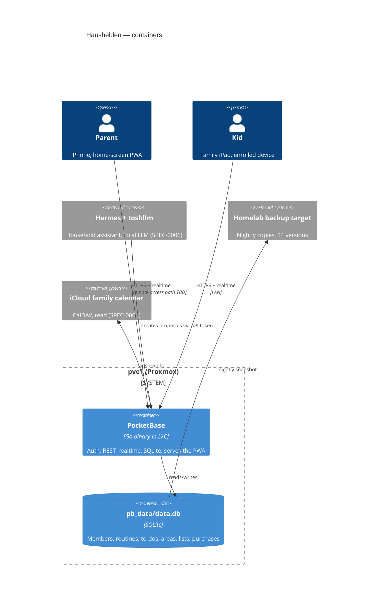
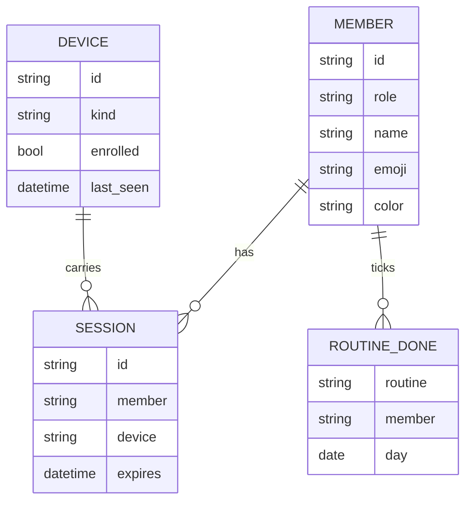

# Design: Household Platform

## Context

The prototype (SPEC-0001 Overview) proved the interaction design with the family but stores everything per device.
The household has two parents with iPhones, two kids (8 and 12) with iPads, and a homelab: Proxmox node `pve1`
(i5-8400T, 16 GB, LXC-first, Ansible from the hub repo), Hermes as the household's agent with a local model on
`toshllm`, and an iMac/NUC estate with existing backup and nginx patterns. There is no remote-access path into the LAN
today (no Tailscale on pve1, nothing exposed), which matters because a shopping list is used outside the house.

Constraints: no paid SaaS (the family explicitly rejected paid planners); household data stays in the homelab; one
maintainer (plus agents) — the stack must be small enough that Claude or Hermes can maintain it from a spec.

## Goals / Non-Goals

### Goals
- One shared, live data set for four people on six-ish devices
- Kids never type a password; parents' data is not readable by kids
- Works in a supermarket with poor signal
- Rebuildable from Ansible + backup in under an hour
- Keep the prototype's single-page PWA so the UI work carries over

### Non-Goals
- Multiple households, invitations, or anything multi-tenant
- Native iOS apps or App Store distribution
- Fine-grained per-record sharing beyond parent/kid roles
- Push notifications in this spec (see SPEC-0003 reminders)

## Decisions

### Backend: PocketBase in one LXC

**Choice**: PocketBase (single Go binary: SQLite, auth, REST, realtime subscriptions, admin UI) in an LXC on pve1,
serving both the API and the static PWA.
**Rationale**: Covers accounts, storage, realtime and an admin UI with one process and one SQLite file — the smallest
thing that satisfies "Shared State and Live Sync". Backup is a file copy of `pb_data/`. JS hooks cover the few
server-side rules (kid scope, purchase recording).
**Alternatives considered**:
- Vikunja (already running in the homelab): good task model, but adult-only UI and no shopping/learning model; we would
  still build the kids' UI against an API shaped for something else.
- Donetick: chore rotation and NFC are nice, but no to-do areas, no learned shopping, and again a second UI.
- Custom Node/Go API + Postgres: full control, but rebuilds auth, realtime and an admin UI we get for free.
- Firebase/Supabase cloud: violates the no-third-party-storage constraint.

### Kid access via enrolled devices, not kid accounts

**Choice**: A parent enrolls a device once; the device holds a long-lived device token scoped to `kid` capabilities.
Profiles are picked on "Wer bist du?". Parent views on that device need a parent PIN.
**Rationale**: Matches how the prototype is used (a shared iPad, tap your face) and keeps passwords away from an
8-year-old. Scoping on the device token means a kid can at worst tick a sibling's tile, which the UI already prevents.
**Alternatives considered**:
- Kid accounts with passwords: friction for the 8-year-old, no security gain inside one household.
- No auth on the LAN: fails once remote access exists and exposes parent to-dos to anyone on the Wi-Fi.

### Offline: service worker shell + local write queue

**Choice**: Network-first service worker for the app shell (already in the prototype), IndexedDB mirror of the last
synced records, and an outbox of mutations replayed in order on reconnect. Conflict rule: last write by server receipt
wins per field; "bought" is sticky.
**Rationale**: The only real offline moments are supermarkets and the car; the data is small (hundreds of records), so
a full mirror is cheap. Per-field last-write-wins is predictable enough for four people; the sticky "bought" rule
removes the one conflict that would lose real information (a purchase date).
**Alternatives considered**:
- CRDT library (Yjs/Automerge): correct but heavy for this data shape and harder to back up and inspect.

### Remote access: decided separately (open)

**Choice**: Not decided here; captured as an open question. The spec only fixes the security bar (no unauthenticated
data endpoints, iOS-trusted TLS).
**Rationale**: Both candidates touch the whole homelab, not just this app. Candidates: Tailscale on every family device,
or one reverse-proxied hostname under the household's own domain with a wildcard certificate.

## Architecture

Capability-specific collections (routines, todos, areas, lists, shop items, purchase history, mascot lines,
proposals) are defined in SPEC-0002 to SPEC-0006 designs.

## Risks / Trade-offs

- **SQLite single writer** → fine for four people; PocketBase serialises writes. Revisit only if the assistant starts
  bulk-writing.
- **PocketBase is pre-1.0** → pin the version in Ansible, upgrade deliberately after reading release notes, test restore
  after each upgrade (the Backups requirement already demands it on format change).
- **iOS PWA storage eviction** → iOS may clear an unused PWA's storage after weeks; the server is the source of truth,
  so the cost is a re-sync and, for parents, a re-login.
- **Parent PIN on a shared iPad is weak** → it only guards against curious kids, which is the threat model; real
  authentication stays passkey/password.

## Migration Plan

1. Build the LXC and PocketBase via a new Ansible role; restore-test an empty backup.
2. Port the prototype UI to read/write PocketBase instead of localStorage, keeping screens identical.
3. Add an "Export for migration" button to the prototype; import that file once on the server.
4. Enroll the kids' iPad, sign in both parents, run in parallel with the prototype for a week.
5. Point the home-screen icons at the new URL; keep the GitHub Pages prototype as a design sandbox or remove it.

Rollback: the prototype keeps working from GitHub Pages with its own local data throughout.

## Open Questions

- Remote access path: Tailscale on all family devices, or one reverse-proxied public hostname with app-level auth?
- Where exactly do backups go — the existing offsite-copy target, or a new PBS datastore?
- Parent PIN length and lockout on the shared iPad (4 digits with the 5-attempt limit, or 6)?
