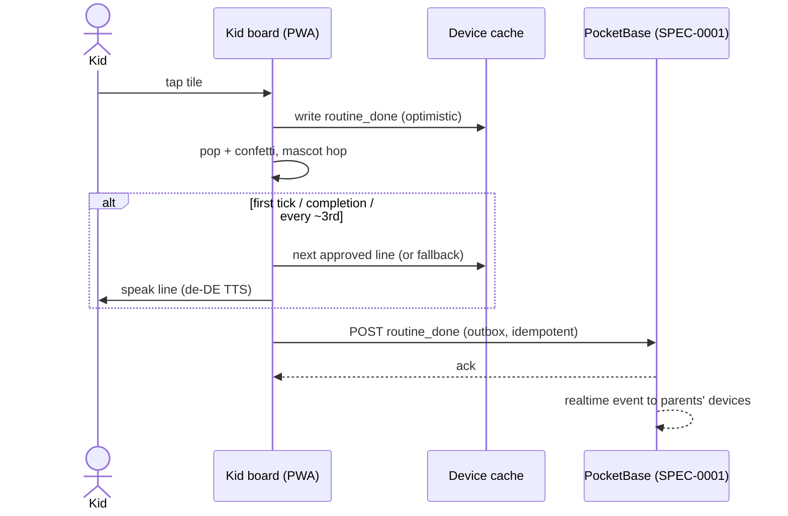
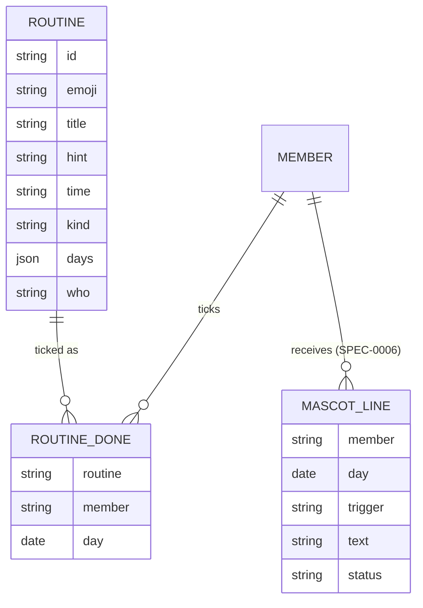

# Design: Kids' Routine Board

## Context

SPEC-0002 formalises the part of the prototype the family has already seen: per-kid tiles, alternating chores,
hobbies with a "tomorrow" hint, a week strip, a streak, and a mascot that talks now and then. The kids are 8 and 12 and
use a shared family iPad (enrolled per SPEC-0001). The mascot's lines come from the household assistant (SPEC-0006);
this design covers how the board consumes them, not how they are written.

## Goals / Non-Goals

### Goals
- Zero-learning UI: a kid can use it the first time without explanation
- Feedback that motivates for months, not just the first week (no praise fatigue)
- Same routine model for kids' chores, kids' hobbies and parents' recurring chores
- Deterministic rules every device computes identically (alternation, streak)

### Non-Goals
- Points, rewards, pocket money or leaderboards
- Kids editing their own routines
- Reminders/notifications to kids (the family decides when the board is opened)

## Decisions

### One routine model with an assignment enum

**Choice**: `routine { emoji, title, hint, time?, kind: chore|hobby, days: [0..6], who }` where `who` is a member id,
`kids`, `kids_alternating`, or `parents`.
**Rationale**: The prototype showed that parents' recurring chores (bins out) and kids' hobbies fit the same shape;
one model keeps the calendar (SPEC-0004) and the parents' "Routine heute" (SPEC-0003) as pure views.
**Alternatives considered**:
- Separate hobby/event model: duplicates weekday scheduling for no gain until events need end times or locations.
- RRULE (iCalendar recurrence): more expressive ("every second Saturday"), but the family's routines are all weekly so
  far; revisit if a fortnightly kid chore appears.

### Alternation by day number parity

**Choice**: For `kids_alternating`, the due kid is `kids[dayNumber mod kidCount]`, with kids in a stable order.
**Rationale**: Needs no stored state and every device agrees offline. Fairness over a week differs by at most one turn.
**Alternatives considered**:
- Rotate on completion ("whoever didn't do it last"): fairer when someone skips, but needs shared state and makes the
  board depend on sync for correctness.

### Ticks stored per member, item and day

**Choice**: `routine_done { routine, member, day }` with a unique index on the triple; un-tick deletes the row.
**Rationale**: Idempotent under offline replay (SPEC-0001 Offline Operation), trivial streak and week-strip queries,
and it survives later edits to the routine's weekdays.

### Mascot speaks sparingly; lines are pre-approved

**Choice**: Visual reaction on every tick; speech on the first tick, on completion, and roughly every third tick
(a counter plus a 25 % chance). Lines are fetched once per day per kid from the approved set (SPEC-0006), cached
offline, with a built-in German fallback pool.
**Rationale**: Constant praise turns into noise within a week. Pre-approved lines mean the kids' devices never call
an LLM and a parent could have seen every line first.
**Alternatives considered**:
- Live LLM call per tick: latency on every tap, needs the network, and unreviewable output to children.

## Architecture

## Risks / Trade-offs

- **Praise fatigue despite sparing speech** → monitor with the family after a month; the assistant's context-aware lines
  (SPEC-0006) are the main counter-measure.
- **Kid ticks without doing the task** → by design there is no verification; parents see ticks live and can talk about
  it. Adding photo proof would change the tone of the app.
- **Parity alternation drifts unfairly over holidays** → acceptable; a parent can temporarily reassign the item.
- **iPad speech voice quality** → the enhanced German voice must be downloaded once in iOS settings; document it in
  the set-up notes.

## Migration Plan

The prototype's `items` and `done` map directly onto `routine` and `routine_done` (prototype `both` → `kids`,
`rotate` → `kids_alternating`, `parents` → `parents`). The prototype export/import in SPEC-0001 carries them over.

## Open Questions

- Should the 12-year-old get her own phone profile in addition to the shared iPad?
- Do weekend chores need a different board look (e.g., "Wochenende" header) or is the same board fine?
- Does the family want a fortnightly kid chore soon, which would justify RRULE recurrence?
