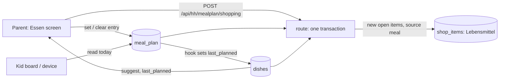

# Design: Weekly Meal Plan

## Context

Kathrin asked for a weekly meal plan (2026-10-16). The app already has shared grocery lists that learn what is bought
(SPEC-0005) and a computed calendar (SPEC-0004). The meal plan should connect to the first one, not become a recipe
manager: it answers "what do we cook on which day" and "what do I have to buy for that".

## Goals / Non-Goals

### Goals
- Plan a week in a minute, from dishes the family actually cooks
- Turn the plan into a shopping list without typing ingredients twice
- Let everybody, kids included, see today's meal, propose meals, and say what they think of it

### Non-Goals
- Recipes with steps, quantities or portions, nutrition, or imports from recipe sites
- Ingredient quantities and unit conversion (names only; the list shows items, not amounts)
- Putting meals into the family calendar (the week grid is the view)
- An LLM proposing a week in v1 (SPEC-0006 MAY propose entries later through the same collection)

## Decisions

### Two collections: `dishes` and `meal_plan`

**Choice**: `dishes` (name, emoji, `ingredients` as a text field of lines, `last_planned` date) and `meal_plan` (`date`,
`slot` = lunch|dinner, `title`, optional `dish` relation, optional `cook` member relation, `note`, `added_by` member),
with a unique index on `(date, slot)`, and `meal_votes` (`entry` relation with cascade delete, `member`, `value` = up|down)
with a unique index on `(entry, member)`. `dishes` also carries `added_by`.
**Rationale**: Entries stay readable when a dish is deleted (`title` is copied and the relation is optional); the unique
index makes "one entry per slot" a database fact rather than a UI habit; week records are unnecessary because a week is
a date range.
**Alternatives considered**:
- One record per week holding seven days: breaks concurrent edits by two parents and makes copy/clear awkward.
- Entries only as free text: loses the ingredient link and the rotation hint.

### Ingredient list is a text field, one name per line

**Choice**: `dishes.ingredients` is plain text; the server splits lines, trims, drops empties and applies the shopping
list's name normalisation.
**Rationale**: Kathrin types a dish once; there is no structure to maintain and no quantities to get wrong. Matches the
"names only" rule of the shopping list.
**Alternatives considered**: a related `ingredients` collection: more screens for no gain at household scale.

### The shopping action is a server route

**Choice**: `POST /api/hh/mealplan/shopping` with either `{ from, to }` (dates, at most 14 days) or `{ dish }` (a single
dish, no dates) runs in one transaction: collect the dishes of the entries in range (or the one dish), normalise names, skip names already open or in the cart on the grocery list, create
items marked with the entry they came from, return `{ added, existing }`.
**Rationale**: Same reasoning as ADR-0006/0007: two parents pressing the button at once, or a replayed offline request,
must not duplicate items; the existing add-item rules are reused rather than copied into the client.
**Alternatives considered**: client adds items one by one: duplicates under concurrency and a half-done list on a flaky connection.

### Rotation hint is deterministic

**Choice**: Suggestions sort by `last_planned` ascending (never planned first); the label is computed on the device from
the date. `last_planned` is set by a hook when an entry referencing the dish is created or moved to a later date.
**Rationale**: Explainable ("zuletzt vor 21 Tagen"), no model, works offline for reading.

### Copy is a client operation on the entries, replace/fill chosen by the parent

**Choice**: Copy creates the target week's entries through the same collection API; "fill only empty" skips slots that
already have an entry, "replace" updates them. Nothing is deleted before the parent chooses.
**Rationale**: No special server route is needed because the unique index rejects collisions and the outbox already
replays writes.

### Kids propose, parents override, everyone votes

**Choice**: List/view rules allow any authenticated principal. Parents and PIN sessions create, update and delete anything
(same helper as `todos`). A family device may create an entry or dish (the unique index rejects an occupied slot), and
may update or delete a record only when its `added_by` equals the member the client names; `added_by` cannot be changed
after creation. Votes: a device or parent may create, update and delete only a vote whose `member` is the acting member.
**Rationale**: "Parents can override" falls out of the rules: a parent replacing an entry sets `added_by` to themselves,
so the child's edit rule no longer matches. Replacing an entry deletes it and creates the new one, which removes the old
votes through the cascade. This is the same trust level as ticking and shopping on a shared iPad (ADR-0003): the member
is the profile chosen on the device.
**Alternatives considered**:
- Kids' proposals need parent approval: more friction than the household wants for a dinner idea; parents can always overwrite.
- A reaction field on the entry: cannot hold one vote per member.

## Architecture

## Risks / Trade-offs

- **Name matching is only case and whitespace** → "Zwiebel" and "Zwiebeln" are different items until the assistant proposes merges (same limit as SPEC-0005).
- **No quantities** → the list says what to buy, not how much; the family decides in the shop.
- **A child overwrites another child's proposal on a shared iPad** → the rules cannot tell children apart on one device; the profile chosen on the device is trusted, as for shopping, and parents can always correct it.
- **Two parents edit the same slot** → the unique index makes the second write an update or a visible conflict, never a duplicate.

## Migration Plan

New collections via a migration; no change to existing data. Rollback by deploying the previous tag; the new collections
are ignored by older code.

## Open Questions

- Decided with Kathrin on 2026-10-16: no breakfast, the week starts on Monday, kids add meals and dishes, parents override, everyone votes, the ingredient action also works for a single dish.
- Should thumbs down ever remove a dish from the rotation suggestions? (Spec says no; revisit after real use.)
- Votes are tied to an entry; should a dish's tally also appear on the kids' side or only in the library?
