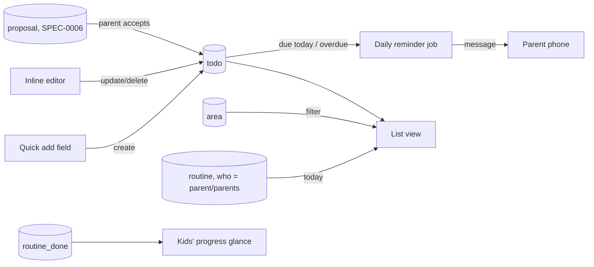
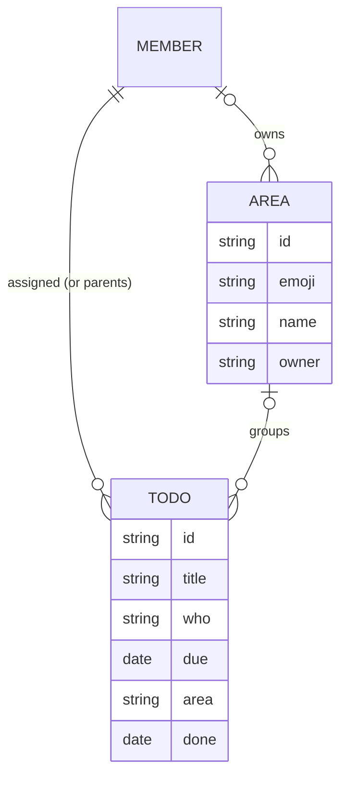

# Design: Parents' To-dos and Areas of Responsibility

## Context

The original request was a family planner with "all overall areas of responsibilities and their main POC, list of
todos, reminders". The prototype added a parent profile with quick add, grouped lists, an inline editor and area cards
with owners; this spec (SPEC-0003) makes that the production behaviour. Two parents share most things but each wants to
see "mine" first. Areas carry the "who is responsible" conversation the family wants to have once and then see daily.

## Goals / Non-Goals

### Goals
- Capture a to-do in under five seconds on a phone
- Make ownership of household areas visible without a meeting
- One place that shows "what's mine today", including recurring chores and the kids' status

### Non-Goals
- Sub-tasks, checklists inside to-dos, attachments, comments
- Projects or Kanban boards (Vikunja covers that for the homelab)
- Delegating to-dos to kids (kids get routines, SPEC-0002)

## Decisions

### Assignee is a parent id or "parents"

**Choice**: `todo.who ∈ {parentA, parentB, parents}`.
**Rationale**: Covers "mine", "yours" and "ours" with one field and keeps the list queries trivial. Matches the
prototype's quick-add chips.
**Alternatives considered**:
- Multi-assignee list: no case in a two-parent household that "parents" doesn't cover.

### Areas are a light tag with an owner, not a container

**Choice**: `area { emoji, name, owner? }`; to-dos reference an area optionally. Deleting an area unlinks its to-dos.
**Rationale**: Areas exist to answer "who is responsible" and to filter, not to structure work. A to-do without an area
is normal. Owner is optional so the family can create the list first and assign owners in a conversation.
**Alternatives considered**:
- Areas as projects with their own lists: heavier UI, and most areas have zero or one open to-do at a time.

### Reminders through the household assistant channel

**Choice**: Default channel is a daily message via the household assistant's existing messenger integration
(SPEC-0006); iOS Web Push from the PWA is the alternative if the family prefers not to involve a messenger.
**Rationale**: Hermes already delivers messages to the parents' phones reliably; Web Push on iOS requires the PWA to be
installed and permission granted per device, and has been flaky across iOS updates.
**Alternatives considered**:
- E-mail reminders: ignored in practice.
- Calendar alarms via iCloud: would duplicate to-dos into the calendar.

### Assistant writes proposals, never to-dos

**Choice**: The assistant's API token can create records only in `proposal` (SPEC-0006); a parent's accept converts a
proposal into a to-do in one transaction.
**Rationale**: Mirrors the homelab's existing gating (agents propose, a human moves things to Ready) and keeps the
to-do list trustworthy.

## Architecture

## Risks / Trade-offs

- **"Both parents" to-dos nobody does** → shared to-dos show "für beide" and stay visible in both lists; if it becomes
  a pattern, add a "take it" action that reassigns to the tapper.
- **Reminder channel depends on the assistant** → if Hermes is down, reminders stop; the lists themselves are
  unaffected. Web Push stays the fallback option.
- **Area list drifts from reality** → it's cheap to edit; the open count per card makes stale areas obvious.

## Migration Plan

Prototype `todos`, `areas` and `adults` map 1:1 (prototype `p1`/`p2` → parent member ids). Carried by the SPEC-0001
import.

## Open Questions

- Reminder channel: Hermes message (Telegram today) or Web Push from the PWA?
- Should completed to-dos older than N days be archived out of sync to keep devices light?
- Should areas have a second "backup" contact?

## As Built: Notes and Known Gaps

- `todos.who` is a text field holding a parent member id or the literal `parents`; the create and update rules refuse a kid id
  or an unknown id. The API lets either parent read and edit any to-do (as the spec requires); the screen shows a parent's own
  and shared to-dos.
- `todos.area` became a relation to `areas` without cascade, so deleting an area clears the field and keeps the to-dos. The
  migration keeps values that name a real area and drops dangling ones. Devices have no access to `areas`.
- The area card's open count is household-wide while the filtered list is per parent, so a card can show more than the list.
  The spec was updated to say so; it is a product question whether the count should match the list.
- Reminders and proposed to-dos (the household assistant) are not built; both follow after v1.
