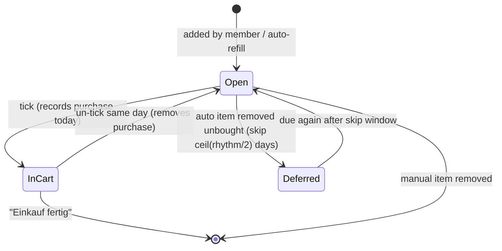
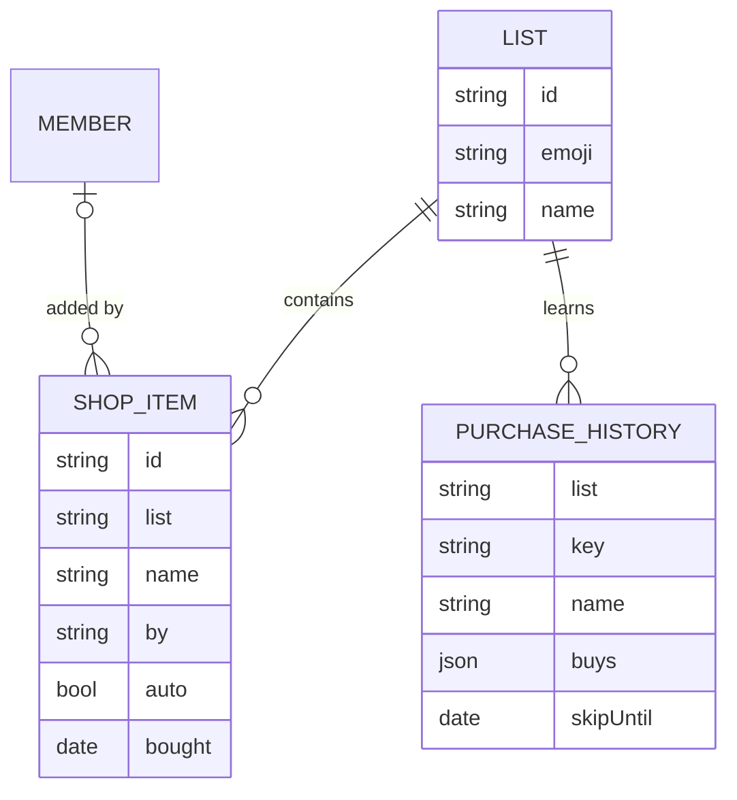

# Design: Shopping Lists

## Context

The request (SPEC-0005) was two lists — groceries and dm — that everyone can add to, and items that are bought often
should populate themselves, "with a learning algorithm or LLM backed". The prototype implements the learning with
purchase intervals and a seeded demo history. A shopping list is the most sync-sensitive feature in the app: two
people edit it, one of them in a store with poor signal.

## Goals / Non-Goals

### Goals
- Adding an item takes one field and one tap, for kids too
- The list refills itself for staples without anyone thinking about it
- The learning is explainable ("etwa alle 5 Tage") and correctable by removing an item
- Works offline in the store and converges afterwards

### Non-Goals
- Prices, budgets, receipts, store loyalty integration
- Recipes or meal planning
- Quantities as a structured field (free text like "2x Butter" is fine for now)

## Decisions

### Rhythm = median of the last five purchase intervals

**Choice**: Per item, store purchase days; rhythm = round(median(last ≤5 intervals)), min 1; due when
`today ≥ last + rhythm − 1`.
**Rationale**: Median ignores the odd week of holidays or a party; five intervals adapt within about a month when habits
change; one day early compensates for "we'll be out tomorrow". It needs no training, runs on the device, and every
suggestion can be explained in one line.
**Alternatives considered**:
- Mean interval: one long holiday gap skews it for months.
- Exponential smoothing: adapts nicely but the reason is harder to show ("etwa alle 5 Tage" vs a fractional estimate).
- LLM prediction: unexplainable, needs the network, and adds no accuracy for a handful of staples.

### Removing unbought defers by half the rhythm

**Choice**: `skipUntil = today + ceil(rhythm / 2)` when an automatic item is removed without being ticked.
**Rationale**: Means "not yet", not "never". Removing it repeatedly keeps pushing it out, which is the user's signal
that the rhythm is too fast; the next real purchase then corrects the rhythm itself.

### Normalised name as the item identity

**Choice**: Identity key = `list + lower(trim(collapse_spaces(name)))`. Display keeps the latest spelling.
**Rationale**: Good enough for one family's vocabulary. Synonyms ("Vollmilch" vs "Milch") are left to the optional
LLM normaliser in SPEC-0006, which proposes merges for a parent to approve.

### "Bought" is sticky under sync conflicts

**Choice**: Inherited from SPEC-0001: once an item is marked bought on any device, a concurrent edit cannot un-buy it;
purchase recording is idempotent per item and day.
**Rationale**: Losing a purchase date corrupts the rhythm; a stray "still needed" is harmless.

## Architecture

Auto-refill runs on the server once a day and whenever a list is opened, so all devices see the same automatic items
(the prototype runs it on the device, which would duplicate items once several devices share a list).

## Risks / Trade-offs

- **Seasonal items (strawberries in June)** → the rhythm adapts after the season ends because removals defer them;
  a "never suggest" action can be added if it gets annoying.
- **Two people buying the same item in different stores** → both ticks record one purchase for that day; the list
  converges to bought.
- **Kids adding junk** → visible avatar per item; parents remove it. No moderation feature.
- **Demo history in the prototype** → must not be imported into production (the SPEC-0001 import drops
  `demoHist` data).

## Migration Plan

Prototype `lists`, `shop` and `hist` map directly; skip `hist` entries when the prototype's `demoHist` flag is still set.

## Open Questions

- Should auto-refill be per list (on for Lebensmittel, off for dm)?
- Is a store-aisle order wanted soon (requires the LLM normaliser or manual ordering)?
- Does the family want a "we're in the store now" signal that tells the other parent to add items quickly?
